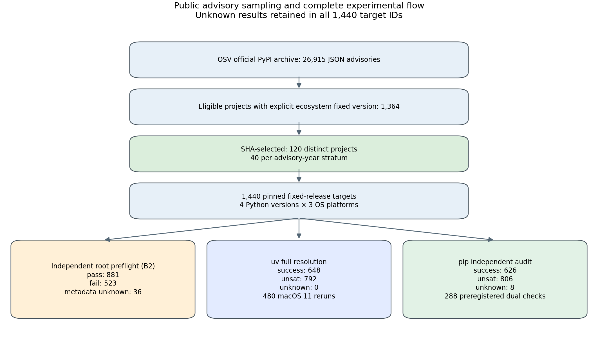
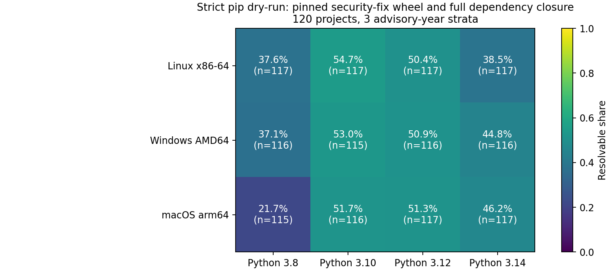
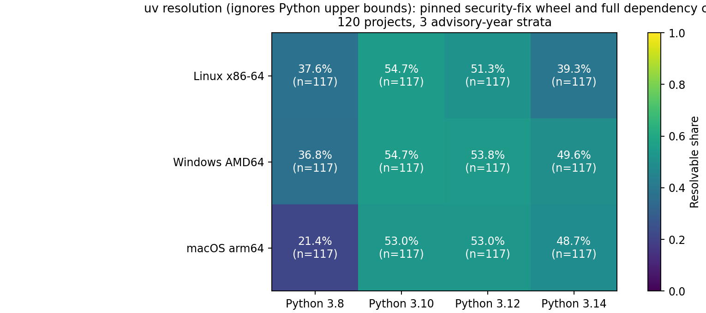
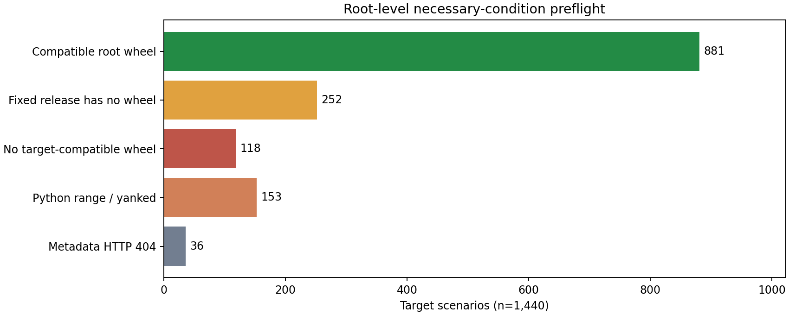
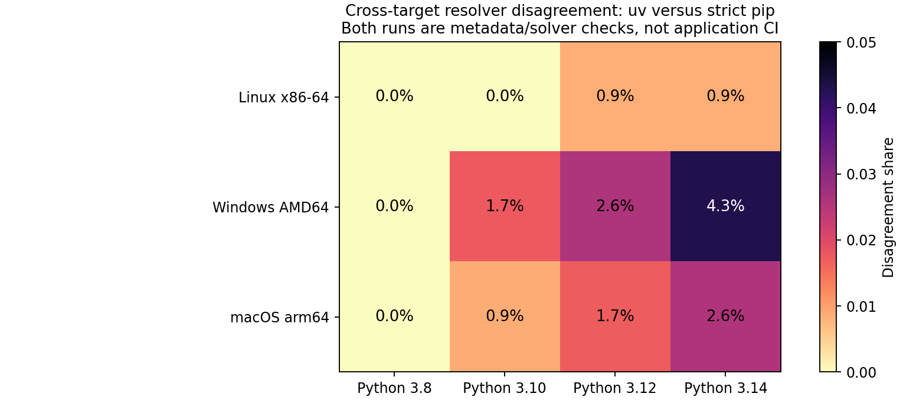

# I01 完整实验报告：安全补丁的运行时可达性悬崖

**英文题目建议：** *The Patchability Cliff: Mapping Runtime and Platform Frontiers of Security Fixes in Python Packages*

**实验日期：** 2026 年 11 月 14 日。**状态：** 完成预先规划的 1,440 个 uv 目标、480 个 macOS 11 修正重跑、以及补充的 1,440 个目标的独立 pip 审计；后者包括针对预先固定的 288 个目标的双模式复核。全部使用公开 OSV / PyPI 数据和本地 CPU，无 GPU、训练模型、付费 API、目标包安装或 CI 测试。

> **最重要的结论边界：** 本研究实际衡量的是“**OSV 明确指出的某一个固定修复版本，在规定 Python/平台下，使用预编译 wheel 的解析可行性**”。这不等于该漏洞不存在其他 backport／安全版本，也不等于应用级修复、运行、编译或测试成功。uv 与 pip 的目标环境语义不同，两套结果必须分开解读。

## 一、摘要与核心数字

从 OSV 官方 PyPI 数据库完整快照的 26,915 个 JSON 条目中，按预先定义的条件得到 1,364 个含有效明确 `fixed` 事件的不同 PyPI 项目；每个项目只选最新公告的一条修复事件，再用冻结的 SHA-256 抽样顺序在三个公告年份层（≤2023、2024–2025、2026）各选 40 个项目。总计 **120 个项目 × 4 个 Python 版本 × 3 个平台 = 1,440 个目标环境**。其中 PyPI 直接提供 117/120 个修复版本的 JSON 元数据，另外 3/120 返回 404；96/120 个修复版本至少发布过 wheel。

以 metadata-only 的必要条件先检查单个修复包：有 881/1440 个目标存在可用且满足 Python 版本范围的非撤回 wheel；523/1440 个目标不通过；36/1440 个目标元数据未知。随后真实执行了所有完整依赖求解。**目标操作系统和 Python 版本的运行时并未被实际启动。**

|衡量项|实测结果|
|---|---:|
|uv（按其文档，忽略 Python 上界）完整解析成功|648/1440（45.0%）|
|严格 pip 跨目标 dry-run 成功|626/1432 可判定（43.7%）|
|两工具都成功|626|
|两工具都判定不可解析|788|
|uv 成功、pip 失败|18|
|uv 失败、pip 成功|0|
|任一工具未知|8|
|macOS 13 默认值改为正式 macOS 11 后，判定发生改变|11/480|

**统计单位与不确定性。** 120 个项目各有 12 个高度相关的配置，不能把 1,440 个目标误作 1,440 个独立项目。按 OSV 年份层内进行 2,000 次**项目级 bootstrap**，在根包 PyPI 元数据可用且对应解析结果明确的子集中得到严格 pip 成功率 44.8%（95% CI 37.5%–52.2%）；uv 成功率 46.2%（95% CI 38.8%–53.4%）；两工具分歧率 1.3%（95% CI 0.4%–2.2%）。404 和未知结果始终单列，不能默认算作失败或成功。这些区间表达对当前**均衡年份抽样设计**的抽样不确定性，并不代表整个 PyPI 的原始分布。

## 二、实验设计与可复现性

**公开来源。** 官方 OSV PyPI 全库快照 `raw/osv-pypi-20261114.zip`，SHA-256 `305dbca79abb7dc1bf52c8466c1be9e7c134b25ec67975c2d395f5259041d22e`；固定修复版本 PyPI JSON 通过 `/pypi/<project>/<version>/json` 获得，每条响应文件与校验哈希保存在 `raw/pypi_responses/` 和 `metadata_index.json`。记录 withdrawn 的公告不纳入合格样本。原始 OSV `fixed` 字段可能与 PyPI 已发布版本不一一对应，404 不经由结果筛选排除。

**独立变量。** CPython 3.8、3.10、3.12、3.14；Linux x86-64/glibc 2.17、Windows AMD64、macOS 11 arm64。修复版本精确钉死为 `project==fixed_version`，依赖链可以由求解器选择匹配版本；只允许 wheel（不编译 sdist），不测试 optional extras。公开源为 PyPI，网络和超时失败不计作不可解析。

**逻辑阶段。**

1. B0 只根据修复版本 `Requires-Python` 判定，忽略 wheel；B1 只看 ABI/OS/版本 wheel 标签，忽略 Python 声明；B2 同时要求**同一个 wheel**满足两者且未被 yanked。
2. B2 是**必要条件预检**，不是完整依赖求解器。B2 失败时，依照上述 wheel-only 定义不能完成目标固定版本安装；B2 成功时仍需解析直接及传递依赖。
3. 在所有 1,440 个目标上运行真实 `uv pip compile`，并按预注册的 macOS 11 设置完整重跑全部 480 个 macOS 子任务；原先错误使用 macOS 13 的原始日志继续保留。
4. 独立验证：预先用哈希固定的 20% = 288 个目标均执行**真实** pip 完整 dry-run 和 `--no-deps`。额外**事后**扩展为全 1,440 目标严格 pip 审计；当 pip `--no-deps` 已拒绝固定根包时，按逻辑推导完整安装不可能，避免重复下载传递依赖，但每条标注为 `inferred_from_no_deps`，不冒充调用过完整解析器。
5. 统计共用同一套原始任务 ID，报告未知、不同求解器分歧、完整调用数量与时间；95% CI 采用 2,000 次按项目聚类并在三个公告年份层内重抽样，随机种子 20261114。

## 三、RQ1：Python 与操作系统如何改变安全修复版本的可达性？

### RQ1a：严格 pip 跨目标解析（声明的 Python 上界被检查）

|目标平台|Python 3.8|Python 3.10|Python 3.12|Python 3.14|
|---|---:|---:|---:|---:|
|Linux x86-64 / glibc 2.17|44/117（37.6%）|64/117（54.7%）|59/117（50.4%）|45/117（38.5%）|
|Windows AMD64|43/116（37.1%）|61/115（53.0%）|59/116（50.9%）|52/116（44.8%）|
|macOS 11 arm64|25/115（21.7%）|60/116（51.7%）|60/117（51.3%）|54/117（46.2%）|

### RQ1b：uv 解析（默认忽略 Requires-Python 上界）

|目标平台|Python 3.8|Python 3.10|Python 3.12|Python 3.14|
|---|---:|---:|---:|---:|
|Linux x86-64 / glibc 2.17|44/117（37.6%）|64/117（54.7%）|60/117（51.3%）|46/117（39.3%）|
|Windows AMD64|43/117（36.8%）|64/117（54.7%）|63/117（53.8%）|58/117（49.6%）|
|macOS 11 arm64|25/117（21.4%）|62/117（53.0%）|62/117（53.0%）|57/117（48.7%）|

分层成功率如下；这是**刻意年份均衡**的样本，不能作为 2023、2024、2026 年真实生态风险发生率的无偏估计。

**严格 pip：**

|OSV 公告年度|成功|可判定|比例|
|---|---:|---:|---:|
|≤2023|220|467|47.1%|
|2024–2025|208|476|43.7%|
|2026|198|453|43.7%|

**uv：**

|OSV 公告年度|成功|可判定|比例|
|---|---:|---:|---:|
|≤2023|220|468|47.0%|
|2024–2025|218|480|45.4%|
|2026|210|456|46.1%|

120 个项目修复版本实际首次上传年份分布：2013: 1, 2014: 1, 2015: 1, 2017: 2, 2019: 3, 2020: 10, 2021: 8, 2022: 12, 2023: 9, 2024: 24, 2025: 20, 2026: 26, missing: 3。公告年份并非修复版本发布日期，这两种时间维度不可互换。

### RQ1c：升级 Python 后能否恢复？

在严格 pip 下，236 组“项目 × 平台”在 Python 3.8 失败，其中 59 组在 Python 3.14 成功（25.0%）。另有 22 组出现**反向可达性悬崖**：Python 3.8 可解析，而 Python 3.14 不可解析。向新版本升级不总是单调地改进历史固定修复版的兼容性。Python 3.8 失败后第一次成功的更高版本的计数为：none: 145, 3.10: 78, 3.14: 3, 3.12: 8。这只是环境可解析性，不是应用迁移的成本或成功率。

## 四、RQ2：根包 wheel 兼容为何不等于整个修复可执行？

881/1440 个场景的目标固定版本通过 B2 必要条件，其中在 uv 全链路解析中仍有 239 个失败（27.1%）；严格 pip 审计中有 247 个失败（28.0%）。该差距直接否定“仅检查固定修复包的 Python 元数据／wheel 就能断言可修复”的做法。阻断既可能来自版本约束，又可能来自传递依赖缺少目标 Python/OS 的 wheel。

在 uv 成功解析的目标中，锁定到的包数量（**包含根包**）中位数为 12.0，最大为 151；这解释了为何仅根包通过检查不足以覆盖复杂传递依赖链。

预检阻断原因分别为：修复版本根本没有 wheel 252 个环境；目标 ABI/OS／Python wheel 标签不匹配 118 个；匹配标签但 Python 版本限制不接受 153 个；API 404 对应 36 个。

典型可复核案例（可从 `uv_full.jsonl`、`uv_macos11.jsonl` 和 pip 结果回看**记录下来的错误信息片段、退出码和完整输出哈希**；过长 stdout/stderr 并未逐字完整存档）：

- **传递依赖 wheel 障碍**：`locust==1.3.2 | py3.12 | windows_amd64`。根包本身可通过检查，但全解析报告传递依赖 `flask-basicauth` 没有可用 wheel；只看根包会漏掉该路径。
- **固定版本的 Mac 平台边界**：`scipy==1.8.0 | py3.10 | macos_arm64`。对应 arm64 wheel 以 macOS 12 为最低版本；错误使用 macOS 13 会返回成功，按 macOS 11 全量修正后失败。
- **解释器上界语义差异**：`streampipes==0.97.0 | py3.12 | linux_amd64`。修复版本声明 `<3.12,>3.8.1`；uv 的宽松上界策略允许解析，严格 Python 声明检查不应直接放行。

## 五、RQ3：预检、基线与独立复核

仅在预先锁定的 288 个场景中比较 B0/B1/B2 的**根包**预测与 pip `--no-deps` 真实退出码，不把 uv 完整解析输出当成根包标签：

|预测方法|正确 / 可判定|准确率|错误放行|错误阻断|
|---|---:|---:|---:|---:|
|B0：仅 Requires-Python|209/282|74.1%|73|0|
|B1：仅 wheel 标签|247/282|87.6%|35|0|
|B2：Requires-Python + wheel 标签|282/282|100.0%|0|0|

严格按同一场景与根包真实 pip `--no-deps` 标签做**成对精确 McNemar 检验**，避免仅比较两个准确率而忽略样本配对；该检验对应预注册的统计方案：

|成对比较|有效配对|仅 B2 正确|仅基线正确|精确 McNemar 双侧 p|Holm 校正 p|
|---|---:|---:|---:|---:|---:|
|B2 对 B0（仅 Requires-Python）|282|73|0|2.118e-22|4.235e-22|
|B2 对 B1（仅 wheel 标签）|282|35|0|5.821e-11|5.821e-11|

其中同时报告对两项预定义比较的 Holm 多重检验校正。p 值只表示根包标签预测方法的配对差异，不表示工业安全补丁修复成功率的因果提升；不能用它代替生产约束与真实软件构建测试。

相较 B0，B2 的成对准确率差异（按项目聚类 bootstrap）为 25.9%（95% CI 18.0%–34.1%）；相较 B1 为 12.4%（95% CI 7.6%–18.0%）。这一比较属于*固定版本 metadata/wheel 的必要条件预测*，**不具备证明全依赖修复方法优于已有工具的效力**。

**预先规定的 288 组 pip 双模式审计：** 完整依赖成功 118、明确失败 168、未知 2。严格 pip **全部 1,440 个目标**的状态为 {'unsat': 806, 'success': 626, 'timeout': 5, 'unknown_error': 3}；其中 406 个完整失败状态是独立 pip `--no-deps` 直接失败所蕴含的逻辑结论，其他目标实施实际完整 pip 解析。实际独立 pip 全解析调用 1034 次，直接 `--no-deps` 694 次。

**两个求解器产生真实冲突，而不是统计噪声。**

官方 uv 文档明确说明，对依赖的 `Requires-Python` 上界会选择忽略；因此可能在其解析中允许 pip 严格拒绝的修复版本。同时 pip 的跨目标 `--python-version` 与 `--platform` 并**不总能替换传递依赖 environment marker 的宿主解释环境**。我们将冲突保留而不投票消除；两者一致是工具层面更强的证据，仍非目标机器真实安装验证。

作为最接近当前宿主解释器与系统的一格，**Linux / Python 3.12** 共 120 个目标：uv 成功 60 个、严格 pip 成功 59 个、两者产生 1 个可判定分歧。这里 wheel 平台仍被固定为 manylinux2014（glibc 2.17），不完全等于宿主 glibc 2.41，因而只是更接近真实同环境验证的交叉核对。

## 六、RQ4：简单预检节省了多少 CPU 求解器调用？

若策略为“先 B2，确实无兼容根 wheel 则立即提示阻断；其余目标再调用完整解析器”，可跳过 523 / 1,440 次 uv 完整求解器调用（36.3%），同时仍保留对元数据未知场景的求解。基于已经实际执行过**全部 uv 对照调用**的单次耗时回放，估计节省 1508.5 / 5637.1 秒的求解器子进程累加时长，即 26.8%。**重要代价：** B2 与 uv 的 Python 上界策略不一致，导致 6 个“uv 判成功”的场景会被 B2 阻断，故不能把该性能数字称为“对原生 uv 无损的加速”。如果采用严格安装语义，必须以 pip 根包及完整版结果单独判断，不能抹去两者冲突。**上述时间也不是部署墙钟时间的真实 A/B 加速比**：元数据 API 获取、求解器缓存冷热、并行调度与两工具语义差异均影响实际收益。

严格 pip 全量审计的实际子进程累加耗时为 6728.1 秒。不能用这一数字与不同缓存状态、不同调用数量的 uv 时间直接做公平速度排名。

## 七、预注册审计、负结果与威胁

预注册规则原文在 `PREREGISTRATION.md`，**不因结果而修改**；四个量化先验门槛：uv_decisive_at_least_90pct=达标；pip_full_decisive_at_least_95pct=达标；root_gate_false_blocks_zero=未达标；at_least_10pct_solver_call_reduction=达标。原预注册将 uv 全解析与严格根包门控的标签直接对齐，事后发现这在 `Requires-Python` 上界上语义不等价。因此如果“零 uv 假阻断”门槛不达标，必须如实计为**不通过**，不能改成 pip 口径后宣称原协议通过。

**透明修正 1：** 初始 uv macOS 目标默认 13 而非预注册 11，导致 11 / 480 个状态不同。全部 480 个场景重新运行，不按原结果选择性重跑；初始 `uv_full.jsonl` 与修正 `uv_macos11.jsonl` 均保留。**透明修正 2：** 发现 uv 忽略 Python 上界后，增加了*明确标注为事后*的完整 pip 审计。所有披露参见 `DEVIATIONS_AND_AUDIT.md`。

**范围威胁与不可推论结论：**

1. 这是 **wheel-only** 约束下精确固定一个 OSV 修复版本的测试；sdist 可编译、其他 backport 或后来安全版本都可能成功。不能把失败当成“漏洞永远无法修复”。
2. 没有客户项目的真实 `requirements.txt` / `pyproject.toml` 固定约束、依赖锁、应用源码 API 调用、构建、单元测试、部署容器及漏洞重新扫描。不能报告“工业项目修复率”。
3. uv 为特定 Python/平台提供最佳努力解析，严格 pip 对外部目标的环境标记可能仍使用宿主环境。缺少对应 OS/解释器的实际运行时，两者都不是完整真实可安装性 oracle。
4. 年度分层被刻意配平：符合条件的最新公告项目实际分布为早期 388 个、中期 67 个、近期 909 个。每层只选 40 个，所以不可把分层样本的整体比例直接说成 PyPI 的真实总体发生率。
5. OSV 版本事件可能指向未发布或撤销的 PyPI 修复版本；3 个元数据 404 没有用其他更容易安装的项目补位。仓库索引会随时间变化；本结论是 2026-11-14 的快照和解析器状态。
6. 所有 1,440 个环境目标来自 120 个项目；统计区间按项目聚类，但项目样本的外部有效性、当前漏洞情报完整性、维护状态等无法由此确证。

## 八、与最相关已有工作的区别及 FSE 2027 工业 Track 的实话评估

|已有工作|公开贡献|本研究应如何避免重复|
|---|---|---|
|[HELP, *Science of Computer Programming* 2024](https://doi.org/10.1016/j.scico.2024.103098)|Python 安装失败的知识库/SMT 诊断；在大量库和安装失败案例中评估，并报告相对于 pip 的效率|**不能**声称“快速预先判断兼容失败”本身新颖|
|[PyChecker, *JSS* 2025](https://doi.org/10.1016/j.jss.2025.112337)|分析解释器版本声明错误及安装失败|需区分“声明错误检测”和“安全修复版能否跨运行时分发”|
|[PCREQ, *TOSEM* 2026](https://doi.org/10.1145/3806394)|真实项目的 Python 依赖升级兼容推断、代码 API 兼容评估和 REQBench（2,095 升级任务）|不应宣称完整项目依赖升级、修复与 API 兼容算法领先；本实验没有代码运行|
|[VulnBump, arXiv 2026](https://arxiv.org/abs/2610.17374)|307 个实际漏洞升级任务、43 个真实仓库，验证扫描、构建和测试|“旧 Python 阻断安全更新”现象已出现于近作；本实验只补充公开多运行时/多平台的细粒度修复版本可达性测量|
|[uv 官方解析语义](https://docs.astral.sh/uv/pip/compatibility/)|公开说明忽略 Python 上界；跨目标解析的能力和局限|不应把官方已知行为包装为新发现或 bug|

FSE 2027 Industry Track [官方 CFP](https://conf.researchr.org/track/fse-2027/fse-2027-industry-papers) 明确允许**具有清楚工业相关性**的研究，不要求作者必须隶属企业；Short paper 为 5 页正文 + 1 页参考文献，Long paper 为 10 页正文 + 2 页参考文献，投稿截止 **2027-01-23 AoE**。本结果有公开、可复现和多环境故障归因的实际价值，但仅凭简单必要条件门控很难与 HELP/PCREQ/VulnBump 在方法创新上抗衡。**目前更合适的是把它作为 FSE Industry Short 的早期实证底稿，不应称为可直接投稿且大概率录用的 Long paper。**

若要达到较强投稿强度，应另外补齐：①多个公开生产软件仓库的**真实依赖约束/CI**，②不止一个 OSV 所列修复版的安全 backport 与替代路径分析，③真实 Linux 多解释器乃至 Windows/macOS 目标环境验证，④明确的工程决策指标（阻断误报、开发者节省时间、修复规划成本），⑤与 HELP、PCREQ、VulnBump 的任务边界及指标可比性。它们是**后续必要工作**，没有在本报告中伪装成已经执行。

## 九、工件、运行环境与复核

本地 Linux x86-64 CPU，Python 3.12.14、pip 26.2.2、uv 0.13.6、packaging 26.3。最多 4 个并发求解器；不使用 GPU、私有数据、大模型或付费 API。工件中的原始 OSV ZIP、120 个样本、可用 PyPI JSON、版本标签判定表、1,440 条 uv 结果、480 条 macOS 修正、全部 pip **结果记录**、288 条冻结双模式验证、项目级 bootstrap 统计、统计图和 `verify.py` 全部可供独立审查。每条执行记录保留结果、耗时、返回码、stderr/stdout 内容哈希和限定长度的输出片段；长输出未完整归档。具体命令见 `README.md`，每份文件 SHA 见 `ARTIFACT_MANIFEST.json`。

**实验负责人后续的诚实边界：** 完成的是此处预先定义的 **CPU-only、公开数据、包发布与解析层面** 的扩大实验；没有在本地虚拟机中验证所有 12 个目标的真实 OS/解释器，也没有完成真实工业应用的漏洞修复闭环。因此这是完整的**所述离线协议**，而不是完整工业部署证据。
