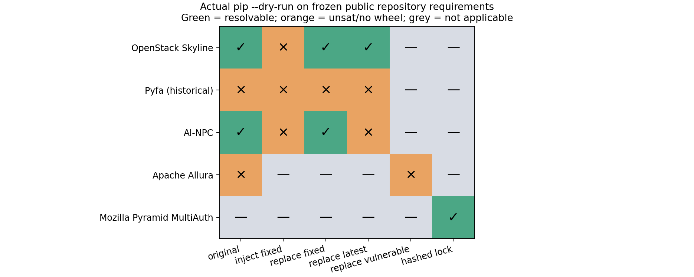
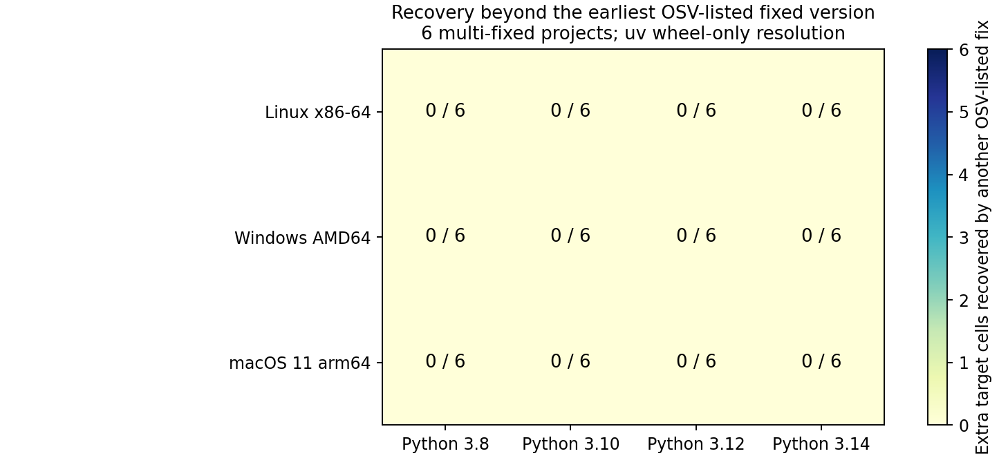

# I01 真实开源项目与替代安全修复路径：完整 CPU 实验报告

**研究补充：** *The Patchability Cliff — From Upstream Wheel Reachability to Real Consumer Constraints and Vendor Backports*  
**日期：** 2026-11-14。**状态：** 独立执行并审计。**计算资源：** Linux x86-64 / CPython 3.12.14，本地 CPU；无 GPU、大型服务器、云模型、付费 API、数据库服务器或生产环境访问。

> **研究对象的真实边界：** 使用公开且已按 SHA 固定的 GitHub 仓库需求声明；完成真实 pip 安装和有限的源仓库单元测试；针对 OSV 多个明确修复事件作全目标 uv 解析；核查官方供应商 backport 公告。**不声称**验证了真实生产环境补丁上线、全部服务集成测试、漏洞利用是否彻底被阻断，或替代版本对所有应用代码都兼容。

## 一、核心结果与相对前一阶段新增的实验

原始独立研究覆盖 120 个项目 × 12 目标 = **1,440 个固定修复版本解析场景**（uv 648 成功 / 792 失败；独立 pip 626 成功 / 806 失败 / 8 未知）。本阶段**保持该原始样本和日志不变**，加入三个真实消费应用依赖方向，以及 OSV 多修复分支和 Linux 发行版 backport 分析。

|新增证据|实测规模或结论|
|---|---:|
|冻结的真实公共 GitHub 仓库|7 个，全部保存仓库 SHA、核心需求文件和哈希|
|真实需求清单与单包对照的 pip dry-run|23 个；14 成功、9 不可解析、0 其他/未知|
|真实 wheel 安装与测试环境|10 个；9 安装且对应测试成功，1 未达到双成功|
|两套实际仓库 pytest，在有漏洞版本与修复版本各跑一遍|Mozilla 每次 43 项 pytest 通过 / 43 项 pytest 通过；pypiserver 每次 316 项 pytest 通过 / 316 项 pytest 通过|
|原始 120 个项目中的多修复事件公告|6 个项目；23 个修复版本事件，首次版本以外新增 17 个|
|额外的完整 uv 依赖求解调用|204，覆盖上述额外事件 × 12 个目标|
|独立确认的旧版本供应商安全更新|2 个 SUSE 旧基版本软件包公告，均明确修复同一 WebOb CVE（本地未安装 RPM）|

**不能混合计算百分比。** 原始 120 项目是按 OSV 公告年份分层抽取；新增 7 个消费仓库是刻意选取约束强弱不同的**目的性案例**，并非同一随机总体。新增 pip 23 次也包括独立根包对照，不能当成 23 个真实软件项目。

## 二、固定的公共真实仓库与可核验依赖

|仓库与锁定证据|关联漏洞包|原始或历史约束|关系与风险边界|
|---|---|---|---|
|[OpenStack Skyline](https://github.com/openstack/skyline-apiserver/blob/8d130ece9600179150a393e3971a4d304a0848e2/requirements.txt)|python-jose|`python-jose<=3.3.0`|对首个修复版本 3.4.0 存在直接**上界冲突**；这不是部署漏洞扫描|
|[Pyfa 历史 requirements](https://github.com/pyfa-org/Pyfa/blob/430e7af225b4b3ef061ea777fb849fdc05f7e7d0/requirements.txt)|python-jose|`==3.3.0`|2026-07-31 文件重组前的精确固定；并非当前状态|
|[Pyfa 当前 pyproject](https://github.com/pyfa-org/Pyfa/blob/b79cd902b0bfa56a43cc5c08b6266fa842f25e85/pyproject.toml)|python-jose|`==3.5.0`|同一个真实项目已公开采用更新版本；**不能推测更改动机**|
|[Tinkoff overhave](https://github.com/Tinkoff/overhave/blob/793bbd6cb98c2cd0b1cb432d1cd56bbf77e11518/pyproject.toml)|python-jose|Poetry `^3.3.0`（即 `>=3.3.0,<4`）|允许 3.4.0、3.5.0；仓库现为 archived，不表示当下工业部署|
|[AI-NPC](https://github.com/rainpaw/AI-NPC/blob/6d3dfb80758c2163af72254281d74a5144ba3174/requirements.txt)|fastapi|`==0.109.0`|限制首个 0.109.1，需要修改项目清单|
|[Apache Allura](https://github.com/apache/allura/blob/22b7bfb96a268d4e1c04dee0c71ddcbb4a03f450/requirements.txt)|webob|当前 `==1.8.11`，CHANGES 记载从 1.8.10 升级|实际公开工程中的升级记录；当前锁中其他旧 wheel 故障需单列|
|[Mozilla Pyramid MultiAuth](https://github.com/mozilla-services/pyramid_multiauth/blob/86865c11248a3ac168f5c448be51dfb7cce773b6/requirements.txt)|webob|传递依赖哈希锁 `==1.8.11`|通过生产 `pyramid` 引入 WebOb；单测已复现|
|[pypiserver](https://github.com/pypiserver/pypiserver/blob/70648dbe7193a3687fb48650b0c67287cc69d6b6/uv.lock)|webob|测试依赖锁 `==1.8.11`|**只在测试工具链 WebTest 引入**，不能据此宣称生产组件暴露|

以上为七个仓库，其中 Pyfa 额外比较两份**真实、不同提交版本**的文件，不是第八个独立仓库。全部原始文件与 SHA 位于 `source_manifest.json`、`snapshots/github/`；没有从空中杜撰依赖关系。

三类研究目标来自原始 OSV 样本：python-jose `GHSA-cjwg-qfpm-7377`（首个修复 3.4.0），FastAPI `PYSEC-2024-38`（0.109.1），WebOb `PYSEC-2026-3943`（1.8.11）。截至此次冻结查询，三个项目最新可发布的正式 PyPI 版本分别为 **3.5.0、0.162.7、1.8.11**。这些版本只是针对所选公告的潜在修复候选，不保证不受其他 CVE 影响。

## 三、真实完整需求清单解析：哪种修复可以直接进入工程？

保持其他行原样，只针对目标包追加冲突要求或替换一行约束，执行真实 `pip install --dry-run --ignore-installed --only-binary=:all:`（CPython 3.12 Linux；没有执行项目代码）。根包对照单列为 `root_controls`，不纳入以下真实工程表格。

|真实仓库|约束实验|pip 结果|关键条件|
|---|---|---|---|
|OpenStack Skyline|原始声明|可解析|91 个待安装包|
|OpenStack Skyline|原约束 + 首次修复版|不可解析/无 wheel|目标包版本约束直接冲突|
|OpenStack Skyline|仅替换为首次修复版|可解析|91 个待安装包|
|OpenStack Skyline|仅替换为最新 PyPI 版|可解析|91 个待安装包|
|Pyfa（历史依赖）|原始声明|不可解析/无 wheel|wxPython 4.2.1 缺 Linux CPython3.12 wheel|
|Pyfa（历史依赖）|原约束 + 首次修复版|不可解析/无 wheel|wxPython 4.2.1 缺 Linux CPython3.12 wheel|
|Pyfa（历史依赖）|仅替换为首次修复版|不可解析/无 wheel|wxPython 4.2.1 缺 Linux CPython3.12 wheel|
|Pyfa（历史依赖）|仅替换为最新 PyPI 版|不可解析/无 wheel|wxPython 4.2.1 缺 Linux CPython3.12 wheel|
|AI-NPC|原始声明|可解析|26 个待安装包|
|AI-NPC|原约束 + 首次修复版|不可解析/无 wheel|目标包版本约束直接冲突|
|AI-NPC|仅替换为首次修复版|可解析|26 个待安装包|
|AI-NPC|仅替换为最新 PyPI 版|不可解析/无 wheel|与固定的 pydantic==2.5.3 冲突|
|Apache Allura|原始声明|不可解析/无 wheel|无可用 crank==0.8.1 wheel|
|Apache Allura|仅换回旧版本|不可解析/无 wheel|无可用 crank==0.8.1 wheel|
|Mozilla Pyramid MultiAuth|原始哈希锁|可解析|11 个待安装包|

**关键可复核失败机制：**

1. **OpenStack Skyline：** 原清单与新增 `python-jose==3.4.0` 联合解析产生 `ResolutionImpossible`；仅把 `python-jose<=3.3.0` 替换成 `==3.4.0`，其余真实需求行不变，**pip 全清单解析成功**。这只是解析器结果，不证明 Skyline 服务的实际运行与部署。
2. **AI-NPC：** 原 `fastapi==0.109.0` 与强制 `==0.109.1` 冲突，替换后可解析。直接改用最新 `==0.162.7` 则与项目锁定的 `pydantic==2.5.3` 发生冲突。**“跳到最新”不等于“对旧项目更可安装”。**
3. **Pyfa：** 旧真实清单的全部变体都因 Linux/Python 3.12 下 `wxPython==4.2.1` 不存在兼容 wheel 而无法完整解析。此处**不可**把失败归因于 python-jose，不能宣称 Pyfa 因该漏洞无法修复。当前 Pyfa 已固定 3.5.0，其迁移与历史清单是不同状态。
4. **Apache Allura：** 当前 WebOb 已为 1.8.11，但全量 wheel-only 锁在 `crank==0.8.1` 处失败。该故障与 WebOb 本身无关；不能将其计算为 WebOb 补丁不可达。
5. **Mozilla Pyramid MultiAuth：** 已提交的带哈希真实锁文件完成了 pip 整体解析；WebOb 来自 Pyramid 的传递依赖。

这些否定和失败结果也完整存档，不能只筛选解析成功的项目。

## 四、真正在 CPU 上安装并运行源仓库测试

每个版本在**独立 Python 虚拟环境**中通过 `pip install --only-binary=:all:` 安装，核查实际安装版本，再执行测试；共 10 次相互分离的环境运行。未安装任何 GPU、大模型或数据库服务。为避免虚构“原生 CI”，源仓库自带 pytest 与我们新写的 smoke 分开标注。

|受测项目／组件|版本|真实安装|实际运行的检查|结果|
|---|---|---|---|---|
|rainpaw/AI-NPC|fastapi 0.109.0|成功|真实仓库 HTTP smoke|通过：项目代码 HTTP smoke 通过|
|rainpaw/AI-NPC|fastapi 0.109.1|成功|真实仓库 HTTP smoke|通过：项目代码 HTTP smoke 通过|
|rainpaw/AI-NPC|fastapi 0.162.7|失败|真实仓库 HTTP smoke|未执行：依赖求解冲突|
|mozilla-services/pyramid_multiauth|webob 1.8.10|成功|原仓库 pytest|通过：43 项 pytest 通过|
|mozilla-services/pyramid_multiauth|webob 1.8.11|成功|原仓库 pytest|通过：43 项 pytest 通过|
|pypiserver/pypiserver|webob 1.8.10|成功|原仓库 pytest|通过：316 项 pytest 通过|
|pypiserver/pypiserver|webob 1.8.11|成功|原仓库 pytest|通过：316 项 pytest 通过|
|mpdavis/python-jose|python-jose 3.3.0|成功|研究者编写的常规 JWT smoke|通过：JWT 正常功能 smoke 通过|
|mpdavis/python-jose|python-jose 3.4.0|成功|研究者编写的常规 JWT smoke|通过：JWT 正常功能 smoke 通过|
|mpdavis/python-jose|python-jose 3.5.0|成功|研究者编写的常规 JWT smoke|通过：JWT 正常功能 smoke 通过|

**最重要的工程教训：** WebOb **1.8.10** 按选定的 CVE-2026-54770 公告仍属于受影响版本，却与修复版 **1.8.11** 一样通过了 Mozilla 的 43 项 pytest 通过 和 pypiserver 的 316 项 pytest 通过。因此“项目现有 CI 绿色”**不构成漏洞已修复的证明**。我们没有在这些测试里运行安全漏洞载荷；只能据官方 CVE 标记版本安全状态。

AI-NPC 采用仓库内真实 FastAPI 路由，在 `DEMO_MODE=true` 下以 TestClient 进行 `/` 与 `/openapi.json` **进程内 HTTP 检查**，未调用 Redis 或外部 LLM API；并未覆盖聊天/数据库全流程。python-jose 的三种版本只运行**研究者正常 JWT 编解码 smoke**，不会把正常功能通过解释为安全修复已验证。

## 五、首次修复版之外：原始 OSV 中其他维护分支版本

在原先的 120 个项目中，只有 **6 个项目**的选定公告显式列出多个 `fixed` 版本事件；这些项目总共提供 **23** 个列出的版本，首个版本之外的 **17** 个均分别用真实 uv 对 Python 3.8/3.10/3.12/3.14 × Linux/Windows/macOS 11 做了独立依赖求解（**204 次新增实际调用**）。没有把 meta-only 判定冒充 solver 测试。

|OSV 项目|该公告列出的修复版本|首次修复版成功/12|全部列出修复版至少一个成功/12|净增加|
|---|---|---:|---:|---:|
|aws-encryption-sdk-cli|1.9.0, 2.2.0|11|11|0|
|case-utils|0.5.1, 0.6.1, 0.7.1, 0.8.1, 0.9.1, 0.10.1, 0.11.1, 0.12.1, 0.13.1, 0.14.1|11|11|0|
|jupyterlab|4.5.11, 4.6.4|8|8|0|
|mayan-edms|4.6.12, 4.7.8, 4.8.10, 4.9.7, 4.10.2|0|0|0|
|protobuf|5.29.6, 6.33.5|12|12|0|
|tortoise-orm|0.15.23, 0.16.6|0|0|0|

**总体：** 如果每个公告只允许最早的固定修复版，则上述 6 × 12 = 72 个目标中有 42 个可由 uv 解析；如果在该公告明确列出的全部修复事件版本间搜索，则有 42 个至少存在一个可解析版本，**净新增 0 个目标**。根包 wheel 必要条件则从 54 提升到 54 个目标（增加 0）。这些数是这 6 个项目的**有限候选列表搜索收益**，并非对随机 PyPI 项目的总体效应量。

**限制：** OSV 多个修复事件可能对应互不兼容的维护分支；不能把 `case-utils` 不同分支的修复版本视为可任意迁移的统一版本。uv 官方行为还会忽略 `Requires-Python` 的某些上界，成功依然只是 solver 语义下的 wheel-only 解析成功，不是消费者软件运行测试，也没有替每个版本检查后续其他漏洞。

## 六、不是 PyPI wheel 的修复路径：确实存在的官方 backport

这一部分不靠猜测：我们核查了**SUSE 厂商原始安全公告**，对同一个 WebOb CVE-2026-54770 确认了**两个不同旧版基线的供应商修复软件包**，而 PyPI 官方首次上游修复版是 1.8.11。

|部署生态|公告中的旧基版本安全包|官方公告|本地安装/测试|
|---|---|---|---|
|openSUSE Leap 15.4|`python311-WebOb-1.8.7-150400.11.9.1`|[SUSE-SU-2026:4298-1](https://www.suse.com/support/update/announcement/2026/suse-su-20264298-1/)|未在 SUSE 系统实装；仅厂商声明|
|SUSE Linux Enterprise Server 12 Public Cloud Module|`python-WebOb-1.2.3-3.6.1`|[SUSE-SU-2026:4351-1](https://www.suse.com/support/update/announcement/2026/suse-su-20264351-1/)|未在 SUSE 系统实装；仅厂商声明|

两个公告都明确将更新关联 CVE-2026-54770，证明不能从“上游 `webob==1.8.11` 无 wheel”演绎出“某 Linux 发行版没有安全修复办法”。但它们是**发行版打包版本**，并不等于 PyPI 上传了安全的 `webob==1.2.3` 或 `1.8.7`，也不能自动迁移到普通 `pip install` 的环境。

对照：[Debian CVE-2024-33664](https://security-tracker.debian.org/tracker/CVE-2024-33664) 仍将 Bookworm 的 `python-jose 3.3.0+dfsg-4` 列为受影响；[Debian CVE-2026-54770](https://security-tracker.debian.org/tracker/CVE-2026-54770) 对其旧 WebOb 包仍有待处理状态。**这不是“所有发行版都不支持 backport”或“Debian 永远不会修”的证据**。各发行版状态需要分别报告，不能把一种供应商结果推给另一种。

FastAPI 的 `0.109.1` 可追溯到 [上游修复提交](https://github.com/tiangolo/fastapi/commit/9d34ad0ee8a0dfbbcce06f76c2d5d851085024fc)，WebOb 的 `1.8.11` 亦有 [上游修复提交](https://github.com/Pylons/webob/commit/ff89560643fb252751b4db8806a283b5377f1f07)。**补丁提交存在不代表旧版本 wheel 被安全地重新发布**；真实安全 backport 必须有发行版或维护分支的版本级证据。

## 七、FSE 2027 Industry Track 新颖性和经验教训

这次扩展让论文可以讲一个比单包 wheel 更接近工业的问题：

> **固定版本修复、项目真实依赖约束、现有 CI 信号与发行版 backport 路径并不等价。工业用户面对的是有分支、有服务约束、有包作用域差异的补丁决策，而不是简单的 `pip upgrade`。**

可作为三个具体贡献候选：

1. **真实约束决策失配：** 同一 python-jose 上游修复版，在 Skyline 的上界约束下被拒，在 overhave 的范围约束下被允许；Pyfa 显示历史精确锁和当前新锁的实际差异。
2. **功能 CI 与安全状态分离：** 同一组开源真实测试在修复前/后都通过，不能拿“测试绿”做没有 CVE 的标签。
3. **多条安全修复渠道：** 一些公告记录多个上游固定版本，SUSE 厂商还提供旧基版本 backport；单一 first-fixed wheel 策略低估潜在修复路径。

但还**不能**声称“我们在七家企业生产环境修复了漏洞”：实际数据只是七个公开仓库的已提交需求文件、选择性 CPU 测试、官方安全公告；`Pyfa` 是历史对照，`overhave` 已归档，`pypiserver` 的 WebOb 属于测试依赖。无法估计整个工业生态的平均修复成功率。相关工作 [HELP](https://doi.org/10.1016/j.scico.2024.103098)、[PCREQ](https://doi.org/10.1145/3806394)、[VulnBump](https://arxiv.org/abs/2610.17374) 已研究安装故障或漏洞升级；如果投稿，必须强调**补丁路径决策与可核查的不同证据层级**，不是宣布自己首创依赖冲突检测。

FSE 2027 Industry Track [官方 CFP](https://conf.researchr.org/track/fse-2027/fse-2027-industry-papers) 允许明确相关于工业问题的研究，即使没有企业作者；Short 为 **5 页正文 + 1 页参考**，Long 为 **10+2 页**。有了这些实际案例与明确的因果边界，**短文实证部分明显更完整**；Long 仍建议扩展更多随机选取的真实消费者项目，并在受控 CI 环境复现服务完整测试与真实补丁部署。

## 八、完整复现链路、审计及不可替代的限制

- **数据冻结：** `source_manifest.json` 含 7 个公开 Git 仓库唯一提交 SHA；`snapshots/github/` 为依赖及锁文件的字节快照；`snapshots/osv/` 和 `snapshots/pypi/` 为官方漏洞/版本 JSON，均带 SHA-256。仓库原始源码可按固定 commit 重新克隆，不将大仓库、虚拟环境或专有文件打包进工件。
- **真实解析：** `run_project_audit.py`、`consumer_probe_manifest.json`、`consumer_pip_audit.jsonl`，成功任务的完整 pip JSON 报告在 `dry_run_reports/`。失败含原 stderr 片段和输出哈希，严格区分目标包冲突与其他基础依赖 wheel 缺失。
- **真实安装和测试：** `run_install_tests.py`、`install_test_manifest.json`、`install_test_results.jsonl`、`install_logs/`。每一步带 argv、退出码、耗时、完整本地日志 SHA，结果由日志重新计算。环境隔离在 `venvs/`，这些可重新创建而不包含在压缩包中。
- **替代修复事件：** `alternative_catalog_manifest.json`、`alternative_metadata.json`、`alternative_preflight_276.json`、`alternative_uv.jsonl`、`alternative_results.json`，版本 API 原始响应在 `alternative_raw_pypi/`。全部 204 条实际 uv 结果单独保留，不与原始首版本实验混淆。
- **厂商 backport：** `vendor_backport_evidence.json` 含直接公告 URL、CVE、厂商修复包完整版本及“未在目标发行版运行”的证据级别。
- **复现步骤：** 见 `README.md`；运行 `verify_industry.py` 必须核实输出数目、日志字节哈希及上一阶段的原始工件。只要任务已在 JSONL 中完成，实验脚本不会重复执行，便于中断后继续。

主要局限：① 所有实际安装/单元测试只在本地 Linux CPython3.12；② 不提供数据库、OpenStack 服务、GUI 或产品部署；③ 只允许二进制分发轮子，可能错误排除真实可编译的发行版包；④ 没有跑漏洞 PoC，也不声称功能测试能给出安全标签；⑤ 新消费者是目的性而非随机选择，不给总体 CI；⑥ 最“新”PyPI 版本与 OSV 均为实验日快照，未来会变；⑦ SUSE 的修复版并未在 SUSE VM 上执行，完全依赖其明确厂商公告；⑧ 仓库更改依赖的动机未知，不可事后归因于漏洞。

**结论：** 用户要求的三类 CPU-only 补充证据——真实项目依赖约束、实际安装/项目测试，以及其他上游修复版/供应商 backport——均已落实到公开可追溯的独立材料中。它们明显提高了 I01 的工程实证内容，但**不是生产修复系统、全量 CI 或已可保证中稿的论文**。
