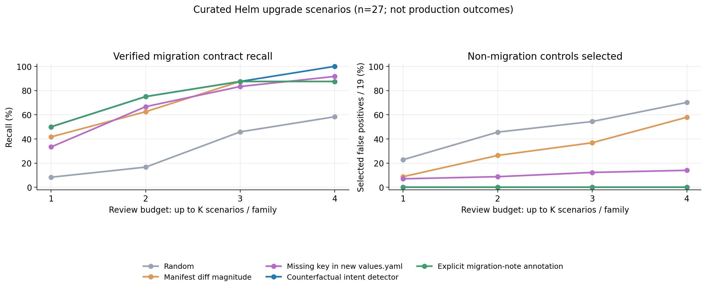
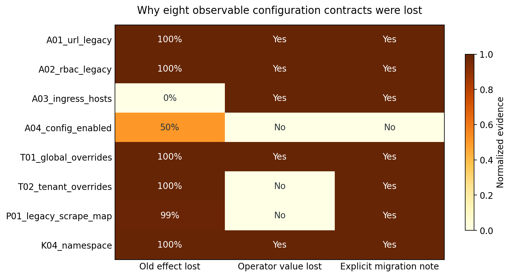

# N02：Helm 升级时配置意图恢复——已执行实验与投稿门槛审计

**研究题目**：*Recovering Configuration Intent Across Helm Chart Upgrades*  
**执行时间**：2026-11-15（北京时间）  
**计算要求**：本地 CPU、没有 GPU / 大型服务器  
**研究状态**：**真实 Chart 上的完整探索性实验已经执行；FSE 2027 Industry 正式论文需要的原生集群验证和强基线比较仍未完成。**

> 必须区分「构造的可执行配置合同失效」与「观测到的生产事故」。本轮 27 个配置状态依据官方版本迁移说明和历史模板构造，不是来自可审计的用户 Release Secret 或企业部署记录。8/8 检出率不能作为生产泛化召回率。

## 1. 数据、版本与可重复性

| Chart 家族 | 旧版本 → 新版本 | 应用与主要考察对象 |
|---|---|---|
| Argo CD | 5.55.0 → 6.0.0 | 旧配置 URL、RBAC、Ingress、ConfigMap 创建策略 |
| Grafana Tempo Distributed | 1.32.0 → 1.33.0 | 全局配置和租户 runtime 覆盖项迁移 |
| Prometheus | 27.0.0 → 28.0.0 | 原有抓取列表及新版默认抓取项 |
| kube-state-metrics | 2.13.2 → 3.0.0 | namespace 配置与 CLI 字段变化 |
| cert-manager | v1.15.3 → v1.16.0 | webhook.config 已知硬错误负控 |

共 **10 份原版 Chart tgz，5 个独立 Chart 家族，5 个历史版本对**。Helm v3.17.0 的所有 10 次 chart lint 均通过，5 个家族的旧/新默认模板均成功渲染。包内 `results/toolchain_and_sources.json` 记录每个文件 SHA-256 和来源。旧 KSM 2.13.2 Chart 从其官方 Git tag `kube-state-metrics-2.13.2`、提交 `1f980d9da0262bb661f9c64b8b3c0dfb443324e2` 构建。

本轮使用了：

- 真正的 Helm v3.17.0 的 `helm template --is-upgrade`；
- Prometheus 官方 v3.8.1 的 `promtool` 与 `prometheus`；
- PyYAML、NumPy 和 Matplotlib；
- 17、29、43 三个排序平局种子，按 Chart 家族重抽样的统计分析。

来源：[Helm Upgrade 官方参数](https://helm.sh/docs/v3/helm/helm_upgrade/)、[Argo CD 迁移](https://github.com/argoproj/argo-helm/blob/main/charts/argo-cd/README.md)、[Tempo 迁移](https://github.com/grafana/helm-charts/blob/main/charts/tempo-distributed/README.md)、[Prometheus 迁移](https://github.com/prometheus-community/helm-charts/blob/main/charts/prometheus/README.md)、[KSM 迁移](https://github.com/prometheus-community/helm-charts/blob/main/charts/kube-state-metrics/README.md)、[cert-manager #7352](https://github.com/cert-manager/cert-manager/issues/7352)。

### 真正执行了什么？

对每个案例，比较四种路径：

1. **Old**：旧 Chart + 旧的用户显式配置；
2. **ResetThenReuse-emulated**：新 Chart 默认值 + 旧的用户显式配置；
3. **Reuse-emulated**：旧 Chart 默认值与旧用户配置合并后，作为新 Chart 的覆盖值；
4. **Migrated**：新 Chart + 对旧用户键完成指定迁移的值。

四条路径都调用真正的 Helm 渲染器，并记录退出码、渲染时间、输出 SHA-256、资源数和关键配置合同；**没有历史 Kubernetes Release Secret，因此两种 Upgrade 策略只是来源代码语义的值合并模拟，不是对真实已安装 Release 执行 helm upgrade**。Helm 的 nil 处理、子 Chart 合并和集群状态可能造成差异。

主脚本一次完成 **5×2 + 27×4 = 118 次 Helm template**。正例全部必须满足旧 Chart 合同成立、新 Chart 渲染成功但合同不成立、迁移后合同重新成立。负例为稳定或无效键。

## 2. RQ1：真实 Chart 上的静默合同失效

在 27 个构造状态中，**8 个正例、19 个对照**。8 个正例属于 Argo、Tempo、Prometheus、KSM **四个独立家族**：

| ID | 旧键 → 新键/修正 | 实际违反的配置合同 |
|---|---|---|
| A01 | `server.config.url` → `configs.cm.url` | 用户 URL 从新 ConfigMap 中消失 |
| A02 | `server.rbacConfig.policy.default` → `configs.rbac.policy.default` | 原先设定的默认 RBAC 角色丢失 |
| A03 | `server.ingress.hosts` → `server.ingress.hostname` | Ingress 仍生成，但原 hostname 丢失 |
| A04 | `server.configEnabled=false` → `configs.cm.create=false` | 旧版不创建的 argocd-cm 在新版被创建；官方迁移段落未明确列出这一旧键 |
| T01 | `global_overrides` → `overrides` | Tempo 全局 metric-generator processor 配置丢失 |
| T02 | 旧 `overrides` → `per_tenant_overrides` | 租户配置进入静态 tempo.yaml，而不是 runtime overrides.yaml |
| P01 | 旧 `serverFiles.prometheus.yml.scrape_configs` 需配合 `scrapeConfigs: null` | 自定义唯一抓取任务变成 11 个任务；正确迁移后重新成为 1 个 |
| K04 | `namespace` → `namespaces: [n02-tests]` | KSM 限定 namespace 的启动参数消失 |

**8/8 正例均成立：Old 合同通过、新 Chart 值重用模拟的合同失败、Migrated 合同恢复。** 所有实际字段值、输入、输出摘要和反事实证据在 `results/case_results.jsonl`。

cert-manager 另外复现了 v1.16.0 的显式 `webhook.config=null` 模板 nil pointer 报错，与公开 Issue #7352 相符。但它属于**无法成功渲染的硬错误**，不是“静默、可以运行”的正例，因此没有混入上述 8 个指标。

## 3. RQ2：自动检测与强基线

研究方法 **Counterfactual Intent Detector（CID）** 不借助正例标签给键计分：

- 在旧/新 Chart 内分别做每个显式键的「有它/没有它」渲染对照；
- 对齐 Kubernetes G/V/K/name，整份 CRD 加减只算一次，避免规模偏置；
- 解析嵌入 ConfigMap 的 Tempo / Prometheus YAML，并按稳定 job_name/name 对齐对象列表；
- 检查旧覆盖的 manifest 影响是否在新版本消失、转移，或输出不再包含独特的用户设置值；
- 组合为固定风险分数，阈值 5 以上建议人工检查。

该阈值和特征是在开发这批场景时形成的，**并非独立盲测之前冻结**。配置输出变化本身不等于运行错误，最终合同标签需要验证具体目标字段。

### 构造样本上的识别能力

| 对照 | 8 个失效正例的召回 | 19 个对照的误报 |
|---|---:|---:|
| **CID 完整版本** | **8/8 = 100%** | **0/19 = 0%** |
| 仅检查新 values.yaml 是否缺键 | 8/8 = 100% | 3/19 = 15.8% |
| CID 去掉用户字面值信号 | 7/8 = 87.5% | 0/19 |
| CID 只保留字面值信号 | 5/8 = 62.5% | 0/19 |
| 人工标注的官方明确迁移说明 | 7/8 = 87.5% | 0/19 |

这里最后一项是**人工读取文档后对具体迁移条目的标注**，不是自动复现了 helm-diff，也没有计算阅读文档的人工时间。7 个迁移点被官方说明明确指出；A04 的旧键未在升级段落中单独列出。文档标注是有额外人类知识输入的强参考。

### 等人工审查条目预算

按每个家族最多看 K 个候选状态；随机平局种子为 17/29/43，仅改变排序，不形成新的独立样本：

| 方法 | K=1 召回 | K=2 | K=3 | K=4 |
|---|---:|---:|---:|---:|
| Random | 8.3% | 16.7% | 45.8% | 58.3% |
| Manifest-diff 差异幅度代理 | 41.7% | 62.5% | 87.5% | 87.5% |
| 新 values.yaml 缺键 | 33.3% | 66.7% | 83.3% | 91.7% |
| **CID** | **50.0%** | **75.0%** | **87.5%** | **100.0%** |
| 官方迁移说明明确条目 | 50.0% | 75.0% | 87.5% | 87.5% |

K=2 时，CID 比单纯 manifest-diff 差异量大 **12.5 个百分点**、比 values 缺键大 **8.33 个百分点**，但与明确迁移文档打平。K=4 时相对文档 +12.5 个百分点，**没有达到原提案要求的 ≥15 个百分点**。更强的 `helm-diff + 官方迁移说明` 联合基线尚未在同一个历史 Release 状态上直接执行。

本轮保存 **7 方法 × 4 预算 × 3 种子 × 27 状态 = 2,268 行选择记录**。使用 5 个家族做 5,000 次聚类 Bootstrap：K=4 CID 相对明确迁移文档的差为 +12.5 个百分点，探索性 95% 区间 **[0, 23.08]**。家族数小且样本构造受主观选择影响，不能把该区间视作生产总体推断；多种子和同家族多配置也不是独立部署。

## 4. RQ3：应用层独立核验，而不只看 Helm 输出

对 Prometheus 真实 Chart 生成的四份配置，调用与新 Chart appVersion 对应的官方 **Prometheus v3.8.1 promtool** 做配置语法校验：

| 输入 | Helm 渲染 | promtool 校验 | 抓取 job 数 |
|---|---|---|---:|
| 旧 Chart 原用户配置 | 通过 | 通过 | 1 |
| 新 Chart，ResetThenReuse 值模拟 | 通过 | 通过 | **11** |
| 新 Chart，Reuse 旧默认值模拟 | 通过 | 通过 | **11** |
| 新 Chart，按迁移说明修正 | 通过 | 通过 | **1** |

还尝试真正启动 Prometheus v3.8.1，读取 `/-/ready` 与 `/api/v1/status/config`：

- **原生 Chart 配置在脱离集群的本地启动失败**：缺 Kubernetes in-cluster discovery 参数和 ServiceAccount CA 文件。保留了错误日志，不能声称原始配置启动成功。
- 为隔离验证**进程实际加载的抓取 job 清单**，将 Kubernetes discovery 和 CA 依赖替换成不可到达的本机 static target，保持全部 `job_name` 不变；禁用外部规则及告警发现。仅监听 127.0.0.1 的两次真实进程启动返回 HTTP 200 readiness，运行时 API 分别返回 **11、1** 个 job。

因此证据达到 **官方应用配置解析 + 本地经过透明适配的真实进程启动/探针**，**没有**到原版 Kubernetes 生产工作负载、实际网络抓取或指标正确性。配置原始内容、适配内容、日志与回执均在 `results/prometheus_configs/`、`results/promtool_parser_audit.json`、`results/prometheus_runtime_probe.json`。

## 5. RQ4：源于旧默认值，还是用户真正显式设置？

对 5 个 Chart 版本对做稳定类型标量默认值扫描，寻找新旧名字相同但默认值改变的键，并构造两份历史状态：

- H0 用户没有显式设置，沿用旧内置默认值；
- H1 用户显式设置了一个**恰好等于**旧内置默认值的值。

找到 3 个候选：Tempo config 模板字符串、Prometheus reloader 镜像 tag、KSM 应用镜像 tag。**3/3** 的旧版输出在 H0/H1 下完全一致，而新版在 reset-then-reuse 语义下输出出现分叉。详见 `results/provenance_twins.json`。

这说明**仅凭旧 manifest 无法恢复写入意图**；但 Helm 官方的 reset-then-reuse 已经借助旧 Release 的 Config 区分 H0/H1，因此**这部分现象不能作为新方法优于 Helm 的证据**。镜像旧版本是否还能运行，没有独立 Kubernetes 试验。

## 6. 论文的止损判断

| 原始 N02 门槛 | 本轮证据 | 结论 |
|---|---|---|
| ≥2 独立 Chart 家族有静默、运行可核验的合同失效 | 4 家族 manifest 合同失效，只有 Prom 完成部分应用层确认 | **未完整满足** |
| 等人工检查预算下，较最强基线召回绝对提升 ≥15pp | 比文档显式条目 K=4 只提升 12.5pp，完整 helm-diff+docs 未跑 | **未满足** |
| 误报率 ≤10% | 样本内 CID 为 0/19 | **探索阶段满足，尚未泛化** |
| 独立家族留出与外部验证 | 所有家族参与探索 | **未满足** |
| 可复现 CPU 实验与原始数据 | 10 Chart、118 模板渲染、27 案例、2,268 排序、10 lint、4 应用 parser、2 本地适配进程探针 | **已满足探索复现** |

**科研决定**：N02 比 N01 更值得继续研究，有四个真实 Helm Chart 家族的具体升级风险，并具备执行成本低的检测器。但目前**不应包装成已完成全部论文实验，也不应直接宣称达到 FSE Industry 的方法有效性门槛**。

正式完成还需：

1. 取得含旧 Release Secret / Config、用户真实修改历史的可审计部署样本，而非只构造已知迁移键。
2. 在隔离 Kubernetes 上对至少两个家族实际执行安装→升级→容器启动/探针，而非只渲染 YAML。
3. 使用**真实旧 Release 状态**直接运行 helm-diff upgrade 与官方迁移说明基线，测量人工检查时间。
4. 先冻结检测算法/阈值，再使用未参加方法开发的新 Chart 家族、未来时间窗做独立确认。
5. 收集实际健康探针、Service/Ingress 可达性、RBAC 权限和抓取数量等行为指标，以排除 manifest 变化但部署行为正确的误判。

## 7. 工件与复核

归档包括：10 份 chart tgz、完整 YAML 构造状态、主实验、默认值来源 twin 扫描、10 Chart lint、Prometheus parser 和本地启动探针、原始 JSONL/CSV、2 张图表、英文 Results 草稿、SHA 与脚本依赖说明。

在解压后的 `N02_experiments/` 目录执行：

`python3 scripts/verify_results.py`

即可**完全离线**核验全部已存数据的主要计数和哈希。大体积 Helm/Prometheus 官方工具二进制不包含在压缩包中；再执行 `bash scripts/bootstrap_tools.sh --with-prometheus` 下载固定工具，然后按 README 顺序重跑完整实验。
