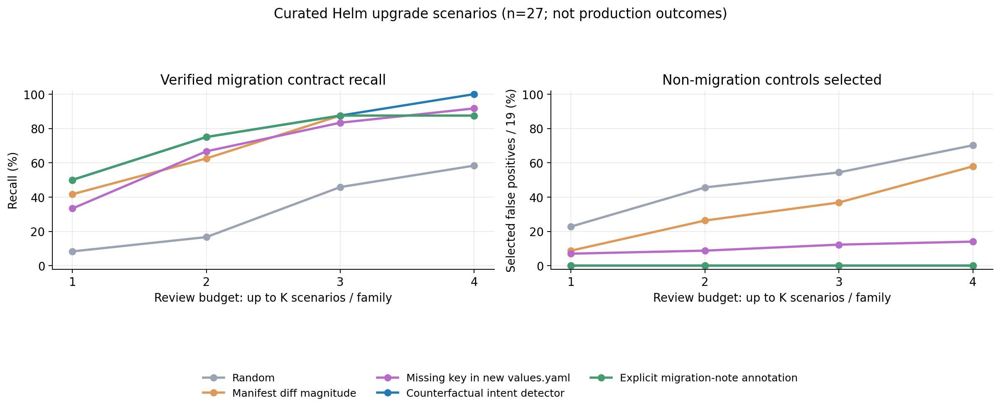
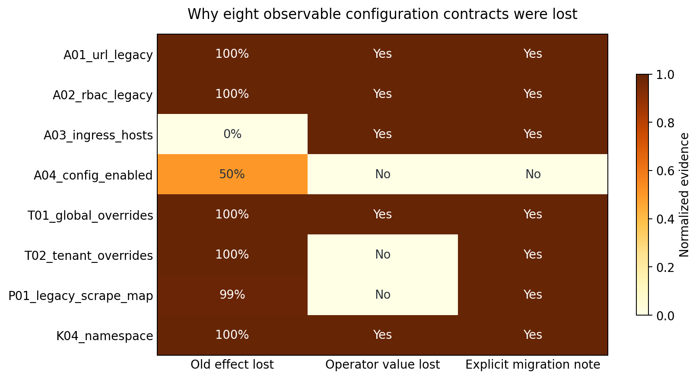

# Recovering Configuration Intent Across Helm Chart Upgrades

## Exploratory experimental results — not a submission-ready Industry paper

### Research questions and scope

We investigate whether an operator's explicit Helm values continue to affect deployable resources across chart upgrades, even when both old and new Helm templates render successfully. The experiment uses **real, version-pinned public Helm chart packages** and the Helm v3.17.0 template engine but **constructed release configurations**. We distinguish three types of evidence: rendered Kubernetes resources, application configuration parsing, and actual application process behavior. Only the first two are broadly available in the current corpus; one locally adapted Prometheus process probe supplements them.

The value-policy comparisons are **source-semantics emulations**: the new chart receives either the previous release's explicit user config (reset-then-reuse) or an overlay that includes the old chart defaults (reuse-values). No persisted Kubernetes Helm Release Secret was available. Thus these findings cannot stand in for executing `helm upgrade` against a historic deployed release.

### RQ1. Are manifest-level intent contracts lost silently?

We obtained five version-pinned chart pairs (ten chart archives): Argo CD 5.55.0→6.0.0, Tempo Distributed 1.32.0→1.33.0, Prometheus 27.0.0→28.0.0, kube-state-metrics 2.13.2→3.0.0, and cert-manager v1.15.3→v1.16.0. All ten chart archives passed Helm lint; default-version rendering succeeded for each.

We constructed 27 deterministic configuration states from public chart migration documentation and source templates. Eight have a migration contract with three independently executable checks: the old chart must satisfy the intended behavior at the manifest/configuration level, the new chart must render but violate it under the previous explicit values, and the new chart must recover the contract after a documented or template-inferred migration. Nineteen states are controls comprising stable keys, benign old overrides, and inert unknown keys.

All eight constructed positive witnesses met those three conditions. The relevant chart families and mechanisms were:

| Family | Witnesses | Rendered behavior |
|---|---|---|
| Argo CD | 4 | Old URL and RBAC map keys ignored; ingress host omitted; formerly disabled ConfigMap created |
| Tempo | 2 | Global override lost; tenant override moved to the static configuration rather than runtime overrides |
| Prometheus | 1 | Explicit single scrape job combined with new chart defaults, increasing job count from 1 to 11 |
| kube-state-metrics | 1 | Old singular namespace value no longer produces a namespace-filter CLI argument |

In a separate hard-failure control, setting `webhook.config=null` on cert-manager v1.16.0 reproduced the upstream nil-pointer template error associated with issue #7352. We excluded this from *silent* witness counts.

These eight examples are **not historical production incidents**. Operator intent was assigned in the study design, and successful template rendering does not establish successful application startup.

### RQ2. Can per-key counterfactual rendering prioritize the failures?

We developed a label-blind risk score using four Helm renderings per configuration: old and new chart, each with and without the old explicit override. The score measures lost per-key effects over resources aligned by kind/name, parses embedded YAML configuration files, matches named collection members by stable identity, and checks whether distinctive user-supplied string values disappear. A resource that is wholly added or removed contributes a single presence change rather than thousands of YAML leaf differences.

In the **curated 27-state corpus**, a development-phase score threshold of 5 identified all eight witnesses without flagging any of the 19 controls. This is an in-sample result; the method, features and threshold were developed with knowledge of these chart migrations and lack an independent held-out validation family.

| Comparator | Recall on 8 constructed witnesses | False positive rate on 19 controls |
|---|---:|---:|
| Counterfactual detector | **8/8 (100%)** | **0/19 (0%)** |
| Absent value key in new defaults | 8/8 (100%) | 3/19 (15.8%) |
| Without distinctive string-retention signal | 7/8 (87.5%) | 0/19 (0%) |
| Distinctive string-retention signal only | 5/8 (62.5%) | 0/19 (0%) |
| Explicitly actionable upstream migration notes, manually annotated | 7/8 (87.5%) | 0/19 (0%) |

Under equal **numbers of configuration scenarios sent for human inspection** (K=1–4 per family), the detector's recall was 50.0%, 75.0%, 87.5%, and 100.0%, respectively. Random selection achieved 8.3%, 16.7%, 45.8%, and 58.3%; ranking by aggregate rendered-manifest diff magnitude achieved 41.7%, 62.5%, 87.5%, and 87.5%; and ranking missing keys in the new default values achieved 33.3%, 66.7%, 83.3%, and 91.7%. Explicit actionable migration-note annotations achieved 50.0%, 75.0%, 87.5%, and 87.5%. Results average seeded tie-breaking at 17/29/43 and do **not** represent three independent experimental replications.

At K=2, the detector exceeded the manifest-diff-magnitude proxy by 12.5 percentage points and the missing-key heuristic by 8.33 points, but tied the explicit migration-note comparator. At K=4, its +12.5-point advantage over explicit migration notes did **not** meet the proposal's ≥15-point effect target. Five-family cluster bootstrap (5,000 resamples) gave an exploratory 95% paired interval of [0, 23.08] points for that latter contrast. This interval cannot support population-level inference because the cases were curated and only five upgrade families were included.

The actual `helm-diff v3.12.0` executable was installed and checked, but a historic release record is required for its real `diff upgrade` comparison. The manifest-diff comparator above is a transparent proxy, **not** a complete implementation of `helm-diff + official migration guide`. No claim of outperforming this stronger industrial baseline is supported.

### RQ3. Can actual application software confirm the generated configuration?

Prometheus v3.8.1's official `promtool check config --syntax-only` accepted all four generated Prometheus configurations. The old chart rendered one explicit scrape job, and the new chart's reset-then-reuse and reuse-old-default emulations each rendered eleven jobs. Clearing the new `scrapeConfigs` field as prescribed by the upstream migration notes restored a single custom job.

We additionally attempted to boot the unmodified generated configs using the official Prometheus v3.8.1 binary. **Both exact-config boots failed outside Kubernetes** because in-cluster Kubernetes discovery and ServiceAccount CA material were absent. We preserved these failures. For an isolated *job-inventory* probe, we then transparently replaced cluster-dependent service discovery and credential-file references with dummy localhost static targets while preserving every job name. The two adapted configurations booted successfully on loopback-only listeners, passed `/-/ready` with HTTP 200, and reported eleven versus one loaded jobs through `/api/v1/status/config`.

This is evidence that a real application parser and process independently accept the divergent **job inventories**; it is **not** evidence of a working original Kubernetes deployment, successful network scrapes, or production impact.

### RQ4. Do explicitly pinned old defaults carry distinct intent?

We also enumerated same-path, same-type scalar default changes between the five chart pairs. Three candidates were present: a Tempo config template string, Prometheus's configmap-reloader image tag, and kube-state-metrics's application image tag. Each gave two old-history configurations with identical old rendered resources: one implicit and one explicitly pinned to the old default. Under reset-then-reuse emulation, the new outputs differed in all three cases. This verifies an observational ambiguity in old manifests, not an unaddressed Helm defect: Helm already retains the prior release's user-supplied Config for this purpose.

### Validity limits and study decision

The main threats are (i) construction and selection based on known upstream migrations, (ii) no real release storage or user intent histories, (iii) lack of original in-cluster startup tests from two independent families, (iv) no matched human-review-minute budget, (v) only five family clusters, and (vi) the absence of a genuinely direct `helm-diff upgrade` comparison. The original proposal's effect gate was not reached against documentation-grounded comparison, and the required in-cluster runtime evidence was not obtained.

We therefore report this as a reproducible, CPU-only feasibility and failure-mechanism study. A credible Industry submission would need real audited release histories, native install→upgrade→probe replays in at least two chart families, proper documentation-plus-helm-diff baselines under measured reviewer time, a detector frozen before evaluation, and held-out families.

### Source references

1. Helm Project, [Helm Upgrade v3 command and reuse/reset options](https://helm.sh/docs/v3/helm/helm_upgrade/).
2. Argo Project, [argo-cd Chart upgrade notes](https://github.com/argoproj/argo-helm/blob/main/charts/argo-cd/README.md).
3. Grafana, [Tempo Distributed Helm Chart upgrade notes](https://github.com/grafana/helm-charts/blob/main/charts/tempo-distributed/README.md).
4. Prometheus Community, [Prometheus Chart upgrade notes](https://github.com/prometheus-community/helm-charts/blob/main/charts/prometheus/README.md).
5. Prometheus Community, [kube-state-metrics Chart upgrade notes](https://github.com/prometheus-community/helm-charts/blob/main/charts/kube-state-metrics/README.md).
6. cert-manager contributors, [Helm upgrade v1.16.0 failing with webhook config error (#7352)](https://github.com/cert-manager/cert-manager/issues/7352).
7. databus23, [helm-diff](https://github.com/databus23/helm-diff).
